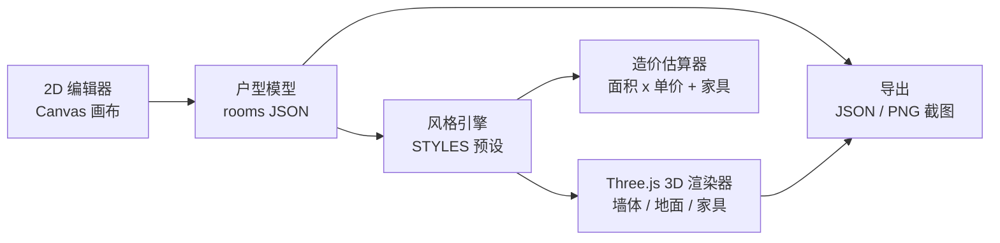

# 3D 户型翻新

> **English summary:** A static single-page web app for home renovation planning. Draw a floor plan in 2D, switch renovation styles (modern / Nordic / new-Chinese / industrial), preview it in 3D with Three.js, get a live itemized cost estimate in CNY, and export the plan as JSON or the 3D view as PNG. No build step, no backend — just open `index.html`.

一个纯静态的户型翻新工具：2D 画户型 → 一键换装修风格 → Three.js 3D 漫游 → 自动算造价 → 导出方案。

## 功能

- **2D 户型编辑器**：网格画布（1 格 = 1 米），按住拖动直接画房间；点选房间后可改名、改类型（客厅 / 卧室 / 厨房 / 卫生间 / 阳台 / 餐厅）、改尺寸、拖动移动、拖右下角手柄缩放、删除。
- **示例户型**：一键加载 1 居室 / 2 居室 / 3 居室示例。
- **装修风格**：现代简约 / 北欧 / 新中式 / 工业风四种预设，切换后墙面颜色、地面材质、家具配色和硬装单价同步变化。
- **3D 预览**：按 2D 平面自动生成 3D 房间（2.8 米层高、带门洞的墙体、按房间铺的地面），家具有床、沙发、茶几、电视柜、餐桌椅、橱柜、浴缸、马桶、绿植等，全部由 Three.js 几何体搭建；支持 OrbitControls 旋转 / 缩放 / 平移，俯视与透视两种机位。
- **造价估算**：按房间面积 × 风格单价算硬装，加上各房间家具逐项计价，分项列表 + 合计实时更新（人民币）。
- **导入导出**：方案存为 JSON 下载、读回 JSON 恢复；3D 视图导出 PNG 截图。

## 快速开始

```bash
# 方式一：直接打开
open index.html        # 或双击 index.html

# 方式二：静态服务器（推荐，可避免个别浏览器的模块限制）
python3 -m http.server 8000
# 浏览器打开 http://localhost:8000
```

> 需要联网加载 Three.js CDN（`cdn.jsdelivr.net`，版本 0.160.0）。除此之外无任何依赖。

## 架构



数据流说明：

1. **2D 编辑器**（`app.js` 上半部分）只负责在 Canvas 上画网格和房间矩形，维护 `rooms` 数组。
2. **户型模型**就是这个 `rooms` 数组：`{ id, name, type, x, y, w, h }`，单位米；JSON 导入导出直接用的就是它。
3. **风格引擎**是 `STYLES` 常量表，提供墙色、地面色、瓷砖色、点缀色和硬装单价。
4. **3D 渲染器**读 `rooms` + 当前风格，重建 Three.js 场景：每间房铺地面、砌四面墙（南墙留 0.9 米门洞）、按类型摆家具。
5. **造价估算器**同样读 `rooms` + 风格，输出分项表；户型或风格一变就重算。

## 文件结构

```
3d-floorplan-renovation/
├── index.html   # 页面结构：工具栏、2D 画布、3D 容器、侧边栏（房间属性 / 风格 / 造价）
├── styles.css   # 全部样式
├── app.js       # 全部逻辑：2D 编辑器、风格、Three.js 渲染、造价、导入导出
└── README.md    # 本文件
```

## 扩展指南

### 加一种新装修风格

在 `app.js` 的 `STYLES` 里加一项即可，不用改别处：

```js
japanese: {                       // key 会出现在下拉框的 value 里
  label: '日式', pricePerSqm: 900,
  wall: 0xf5f0e6, floor: 0xd6c1a3, tile: 0xe8e8e8, accent: 0x8a9a5b,
  desc: '一句话介绍。',
  meta: ['墙面：……', '地面：……', '点缀：……'],
},
```

再到 `index.html` 的 `#style-select` 下拉框里加一个 `<option value="japanese">日式</option>`。

### 加一件新家具

两步：

1. 在 `app.js` 的 `FURNITURE` 对应房间类型数组里加一项：`{ id: 'bookshelf', name: '书架', price: 1500 }`（价格会进造价表）。
2. 在 `buildFurnitureForRoom` 对应房间类型的 `case` 分支里调用搭建函数，用 `box()` / `cyl()` 拼出来，例如：

```js
function buildBookshelf(g, cx, cz) {
  box(1.2, 1.8, 0.3, 0x9c7b54, cx, 1.0, cz, g);
}
```

### AI 编程助手如何扩展本项目

- **改户型模型**：只动 `rooms` 数组结构（加字段如 `wallColor`、`rotation`）时，同步改 `draw2D`、`buildWalls` / `buildFurnitureForRoom`、`computeCost`、JSON 导入校验四处。
- **加 3D 效果**：`initThree` 里集中管光源和阴影；`rebuild3D` 是场景重建的唯一入口，任何户型/风格变化都走它。
- **加新导出**：参考 `btn-export-json` / `btn-export-png` 的 `download()` 工具函数。
- **验证**：改完先跑 `node --check`（把 `app.js` 复制为 `.mjs` 后缀再检查，因为它是 ES Module），再用浏览器打开确认 2D/3D 切换和造价表正常。
- **约定**：保持零构建、零后端；新功能优先用原生 JS + Three.js 几何体实现，不引入重型依赖。
